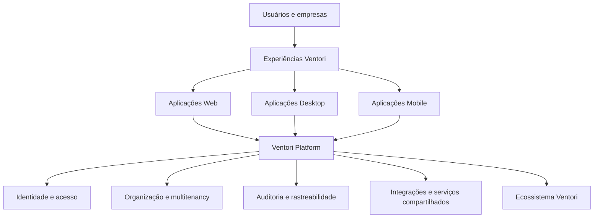

# Ventori Platform

### A base tecnológica do ecossistema Ventori

**Uma plataforma segura, modular e multitenant para gestão empresarial, comunicação e serviços digitais.**

---

## Sobre a Ventori Platform

A **Ventori Platform** é a fundação tecnológica criada para sustentar os produtos e serviços digitais da Ventori em uma arquitetura unificada.

Seu objetivo é oferecer uma base consistente para identidade, acesso, organização, auditoria, integração entre produtos e evolução contínua do ecossistema, evitando que cada solução precise reconstruir os mesmos fundamentos.

A plataforma é desenvolvida com foco em crescimento sustentável, segurança, padronização e experiência de uso.

> **Segurança → Eficiência → Organização → Funcionalidade → Documentação**

Esses princípios orientam as decisões de engenharia e produto da Ventori.

---

## Visão

A Ventori Platform foi concebida para permitir que diferentes soluções compartilhem uma mesma fundação tecnológica sem perder independência de produto.

> O diagrama acima é propositalmente conceitual. A arquitetura interna, topologia de infraestrutura e detalhes operacionais não fazem parte deste repositório público.

---

## Ecossistema Ventori

A Platform é o núcleo sobre o qual os produtos Ventori podem compartilhar identidade, padrões, serviços e integrações.

| Solução | Propósito |
|---|---|
| **Ventori Platform** | Fundação tecnológica, administrativa e operacional do ecossistema |
| **Ventori Food** | Soluções de gestão para operações de alimentação e negócios relacionados |
| **Ventori Mail** | Comunicação e correio eletrônico corporativo integrado ao ecossistema |
| **Ventori TV** | Distribuição e gerenciamento de conteúdo para telas e ambientes comerciais |
| **Ventori Omnichannel** | Comunicação integrada entre empresas, equipes e clientes |
| **Ventori Fleet** | Recursos voltados à gestão e operação de frotas |

O ecossistema é evolutivo. Produtos, integrações e capacidades podem ser incorporados conforme novos cenários de negócio são validados.

---

## Princípios da plataforma

### 🔐 Segurança por design

Segurança não é tratada como uma etapa posterior do desenvolvimento. Ela faz parte da arquitetura, das regras de acesso, dos processos de engenharia e da evolução dos produtos.

### 🧩 Modularidade

A plataforma é organizada para permitir evolução independente de áreas e produtos, reduzindo acoplamento desnecessário e facilitando manutenção.

### 🏢 Multitenancy

A arquitetura considera desde a origem a operação de múltiplas organizações com separação lógica, regras de acesso e contexto próprios.

### 📋 Auditoria e rastreabilidade

Operações relevantes devem poder ser rastreadas, permitindo maior transparência operacional e suporte a investigações, diagnóstico e governança.

### 🌐 Integração

Os produtos Ventori são projetados para compartilhar uma fundação comum e oferecer uma experiência mais integrada ao usuário.

### 📚 Documentação viva

Arquitetura, decisões e comportamentos relevantes devem acompanhar a evolução do software, reduzindo dependência de conhecimento informal.

---

## Tecnologia

A Ventori Platform utiliza tecnologias modernas e amplamente adotadas no desenvolvimento de software corporativo.

| Área | Direção tecnológica |
|---|---|
| **Backend** | C# e ASP.NET Core |
| **Persistência** | PostgreSQL |
| **Aplicações** | Web e aplicações nativas para cenários específicos |
| **Entrega** | Containers OCI e automação de implantação |
| **Escalabilidade** | Arquitetura preparada para ambientes orquestrados |
| **Qualidade** | Testes automatizados e gates de engenharia |
| **Observabilidade** | Métricas, logs, health checks e monitoramento |
| **Segurança** | Princípios de menor privilégio, segregação e validação contínua |

Esta seção apresenta apenas a direção tecnológica pública da plataforma. Versões, configurações, topologias, endpoints e mecanismos internos permanecem privados.

---

## Experiência de uso

A Ventori busca uma experiência visual consistente entre seus produtos, priorizando:

- interfaces limpas e objetivas;
- navegação previsível;
- padronização entre módulos;
- redução de complexidade operacional;
- adaptação a diferentes perfis de usuário;
- experiência coerente entre aplicações web e desktop.

---

## Engenharia e qualidade

A evolução da Ventori Platform segue uma abordagem orientada por validação.

Mudanças relevantes passam por etapas de análise, implementação, testes e verificação antes de serem consideradas prontas para uso.

Entre os objetivos permanentes de engenharia estão:

- reduzir regressões;
- manter limites claros entre produtos e componentes;
- automatizar verificações sempre que possível;
- preservar rastreabilidade das mudanças;
- tratar documentação como parte da entrega;
- evoluir a segurança junto com a plataforma.

---

## O que este repositório contém

Este é um **repositório público de apresentação** da Ventori Platform.

Ele pode conter:

- visão institucional e técnica de alto nível;
- conceitos públicos de arquitetura;
- apresentação dos produtos do ecossistema;
- imagens e demonstrações aprovadas para divulgação;
- informações públicas sobre tecnologia e princípios de engenharia;
- documentação destinada a clientes, parceiros e interessados.

### O que não é publicado aqui

Para proteger a propriedade intelectual e a segurança da plataforma, este repositório **não contém**:

- código-fonte proprietário;
- credenciais, chaves ou segredos;
- arquivos de configuração de produção;
- endereços internos, topologia de rede ou inventário de servidores;
- configurações detalhadas de infraestrutura;
- documentação operacional interna;
- decisões arquiteturais confidenciais;
- dados de clientes;
- relatórios internos de segurança;
- detalhes de vulnerabilidades não divulgadas;
- procedimentos internos de implantação ou recuperação.

Os repositórios utilizados no desenvolvimento da Ventori Platform permanecem privados.

---

## Segurança

A Ventori leva relatos de segurança a sério.

**Não publique vulnerabilidades, credenciais, dados sensíveis ou detalhes exploráveis em Issues públicas.** Consulte [SECURITY.md](SECURITY.md) para orientações.

---

## Status do projeto

A Ventori Platform está em **evolução contínua**. Este repositório acompanha apenas informações consideradas adequadas para divulgação pública e pode ser atualizado conforme novos produtos, recursos e materiais institucionais forem disponibilizados.

---

## Sobre a Ventori

A Ventori desenvolve tecnologia com foco em transformar processos complexos em soluções organizadas, seguras e integradas.

A Platform representa a fundação dessa estratégia: uma base única capaz de sustentar diferentes produtos enquanto mantém padrões comuns de segurança, experiência, governança e engenharia.

---

### Ventori Tecnologia

**Tecnologia construída para evoluir.**

© 2026 Ventori Tecnologia Ltda. Todos os direitos reservados.

Este repositório possui finalidade institucional e demonstrativa. A ausência de uma licença de código aberto não concede permissão para copiar, modificar, distribuir ou reutilizar conteúdo proprietário da Ventori.

